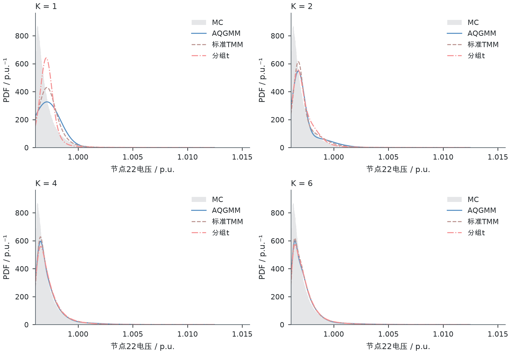
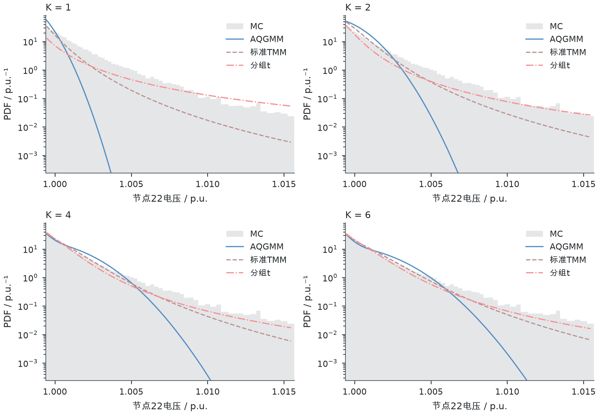
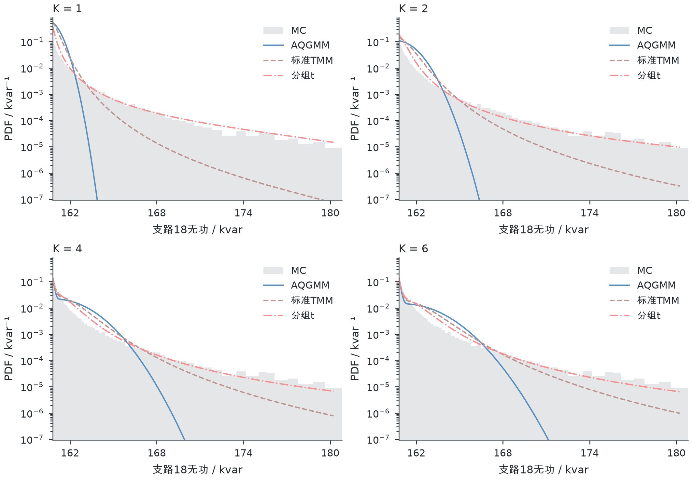

# 节点电压与支路潮流：尾部特征和分布精度

本次检查4种注入情形中全部32个非平衡节点电压、32条在运支路有功和32条支路无功，逐上下尾分析，共768个主要尾侧；有功网损另有8个辅助尾侧。先读取MC确定重点位置，再读取方法误差，没有按TMM是否更准选择电气量。原注入、负荷、相关系数和已保存模型均未改变。

## 哪些位置的尾部特征更强

| 注入情形 | 电压上尾 | 有功下尾 | 无功上尾 | 说明 |
|---|---|---|---|---|
| Pareto | V22、V21、V20 | P32、P17、P31 | Q18、Q30、Q19 | 所列电气量在当前尾段有较强重尾特征 |
| 对数正态 | V22、V21、V20 | P32、P31、P21 | Q18、Q19、Q31 | 电压和有功仅确认尾部延伸，当前幂尾证据不足 |
| 对数逻辑斯蒂 | V22、V21、V20 | P32、P31、P30 | Q18、Q19、Q31 | 所列电气量在当前尾段有较强重尾特征 |
| 混合 | V33、V32、V31 | P17、P32、P31 | Q30、Q31、Q29 | 所列电气量在当前尾段有较强重尾特征 |

上述为每种情形、每种电气量类型按统一MC规则选出的前三项，用于重点出图；并非只有这些电气量存在尾部延伸。节点18仍保留在全部节点比较和完整结果表中。

支路编号对应：17为17→18；18为2→19；19为19→20；21为21→22；29为29→30；30为30→31；31为31→32；32为32→33。有功下尾取真实负向功率，表示反向有功输送增强，没有先取绝对值。

MC结果表明，电压尾部较强的位置与有功、无功尾部较强的位置并不相同。前三种情形中，节点20—22电压上尾的相对延伸强于节点18；混合情形则转为节点31—33更突出。支路17、31、32等靠近随机电源的有功潮流下尾更值得检查。无功中，支路18、19以及29—31的上尾更长，线路无功损耗中的电流平方关系会加强偏斜和上尾延伸。Pareto情形下，重点有功下尾的GPD形状参数约0.19—0.20，重点无功上尾约0.45—0.47；这与有功主要随电源注入变化、无功增量包含电流平方损耗的关系相一致，只解释当前MC尾段，不作为极限尾指数证明。

**尾部更厚与电压值更高、功率变化更大应分开判断。**本次位置排序比较的是相对于中间波动范围的尾部形状；绝对电压水平和潮流变化量见表中的物理分位值。不能把最高尾部延伸比直接解释为最高过电压或过载风险。

## 判断依据与边界

本次用中位数到同侧四分位的距离表示中部波动尺度，再比较0.1%、0.5%、1%尾概率对应的外侧距离，并用同尺度高斯分布归一。高斯标准化尾部延伸比等于1表示对应距离与高斯相同，数值越大表示在同一中部波动幅度下尾部延伸越强。它不使用容易受少数极端场景影响的全分布标准差作为唯一尺度。

同时，在95%、97.5%、99%、99.5%四个阈值的超额量上估计GPD形状参数，保留阈值变化结果；99.5%阈值下的区间通过199组超额场景重取结果计算，为固定阈值的逐点探索性区间，不是全部节点同时成立的证明。筛选说明中的1.25、0.05是本轮探索性标记条件，不是通用重尾判据。

本报告用“当前尾段重尾特征较强”描述多项MC证据，不由有限场景证明渐近重尾。对数正态属于严格重尾、长尾类，但不是帕累托型幂尾；其GPD形状参数接近零不能据此认定为轻尾。因此，对数正态注入下部分电压、有功结果写作“尾部延伸明显，当前幂尾证据不足”。相关定义见[Foss等的重尾分布专著](https://doi.org/10.1007/978-1-4419-9473-8_1)，阈值超额与参数估计见[Hosking与Wallis原文](https://stat.cmu.edu/technometrics/80-89/VOL-29-03/v2903339.pdf)。

尾部延伸比比较的是尾部相对中部的距离，GPD形状参数比较的是当前超额量的衰减形态，两者不必给出相同排序。节点20—22等相近位置的形状参数区间有重叠，不能仅按数值小差异宣称严格强弱。下尾形状检查先将电气量反向后取超额量；实际功率、分位值及误差始终保留原方向。

完整判断依据见[全部电气量MC尾部特征](mc_tail_features_all_quantities.csv)和[重点电气量清单](focus_quantities_mc_selection.csv)。旧的373项MC标记保留在原“尾部筛选”目录，本次没有按新标记删除旧结果。

## PDF图如何阅读

- 已绘制36个重点电气量的全分布PDF和尾部放大图，共72张，每张均包含K=1、2、4、6四个面板，并比较MC、AQGMM、标准TMM和当前分组t。
- 另有12张沿节点/支路编号的全部32项尾部特征图，以及24张MC标准化PDF比较图，合计108张；标准化比较还加入按MC选出的尾部延伸较弱电气量。
- [图册目录](figure_atlas.md)按情形和电气量逐一列出全分布、尾部放大图；[figure_index.csv](figure_index.csv)给出PNG和PDF文件位置。
- 各方法采用同一物理分箱，PDF为区间概率除以区间宽度。没有单独拟合电气量PDF，没有核平滑，尾部没有重新归一化。
- 全分布图显示MC的0.01%—99.99%分位范围；尾部图显示该侧0.01%—5%范围，纵轴采用对数轴。显示范围以外的模型概率仍记录，未从均值、方差或W1计算中删除。零或浮点非正密度在对数轴不能显示，原数值保留在[密度数据](pdf_bin_mean_density.csv)和[显示范围检查](pdf_display_range_check.csv)中。

示例：Pareto注入下节点22的上尾与支路18无功上尾：

## 新增尾部分位区间W1

下尾概率区间为[0.001,0.05]，上尾为[0.95,0.999]。在同一分位水平比较方法和MC的物理分位值，再对该区间的绝对差平均积分：

`尾部分位区间W1 = ∫ |方法分位值(p) − MC分位值(p)| dp / 区间概率宽度`。

这等于各自对应分位区间条件分布之间的W1，保留尾部位置和形状差异。它是明确截去最外0.1%的尾部分位区间W1，不是全分布W1，也不是包含概率0或1端点的完整尾部W1。W1按区间概率宽度归一是指标定义；PDF图仍显示完整分布密度，不随之重新归一。W1的CDF积分关系见[SciPy官方文档](https://docs.scipy.org/doc/scipy/reference/generated/scipy.stats.wasserstein_distance.html)。本次以截取到同一概率区间后的CDF差积分计算，并用已知高斯分布的分位积分独立验算。

电压单位p.u.，有功和网损kW，无功kvar。另给出W1除以MC四分位距的无量纲值，方便比较相对误差规模，但不把不同物理量的原始W1平均成一个分数。W1越小越准确；它与CDF-RMSE、极端分位误差分别报告。

完整结果：[全部电气量W1](../results/tail_quantile_w1_all_quantities.csv)、[三方法W1比较](../results/tail_quantile_w1_method_compare.csv)。9312个尾侧结果均完成积分加密检查；数值差异与积分加密差相近时，不作稳定判优。

## 全分布均值和方差

完整结果：[全部电气量均值方差](../results/full_mean_variance_all_quantities.csv)、[三方法均值方差比较](../results/full_mean_variance_method_compare.csv)。共4656行，覆盖4种情形、4个K、3种方法和97个电气量。

MC均值和方差使用完整百万场景，包括极端场景。方法均值、方差针对完整已保存分布计算，不由图中有限范围的PDF积分，也不由有限次抽取电压来估计。支路功率和网损采用二次型矩关系；标准TMM使用实际自由度对应的精确二阶、四阶矩；分组t对实际截断强度分布自适应积分。节点电压报告幅值的均值和方差，不是幅值平方的统计量。电压幅值的条件积分另用Rice分布特例核验。

均值误差以物理单位和MC标准差归一值报告；方差另给出“方法方差/MC方差”的比值，等于1表示与MC一致。方差单位为p.u.²、kW²或kvar²。MC方差是本批百万场景的经验方差，不从有限尾段形状参数推断总体方差是否有限。

## 同一重点电气量的结果示例

以下固定K=4，完整K和全部36项结果见[三项误差及均值方差总表](focus_quantities_three_metrics_mean_variance.csv)。CDF-RMSE单位为百分点，W1与分位误差使用表中物理单位。

| 情形 | 电气量 | 方法 | CDF_RMSE_百分点 | 尾部分位区间W1 | 极端分位绝对误差_尾概率0_1百分比 | 单位 | 方差比_方法除以MC |
|---|---|---|---|---|---|---|---|
| Pareto | V22 | AQGMM | 0.178684 | 0.0002064818 | 0.002808806 | p.u. | 0.980728 |
| Pareto | P32 | AQGMM | 0.1786142 | 11.23602 | 152.4654 | kW | 0.9804643 |
| Pareto | Q18 | AQGMM | 1.728779 | 0.8428212 | 1.588465 | kvar | 0.9146658 |
| Pareto | V22 | 标准TMM | 0.1342751 | 0.0002123458 | 0.002074245 | p.u. | 0.9807067 |
| Pareto | P32 | 标准TMM | 0.1298601 | 11.05539 | 111.0509 | kW | 0.9807378 |
| Pareto | Q18 | 标准TMM | 1.627347 | 0.6579395 | 1.040872 | kvar | 0.9150912 |
| Pareto | V22 | 分组t | 0.3980947 | 0.0003892323 | 0.001553521 | p.u. | 1.060829 |
| Pareto | P32 | 分组t | 0.1951192 | 13.18147 | 76.86804 | kW | 1.073368 |
| Pareto | Q18 | 分组t | 1.147036 | 0.383524 | 0.550624 | kvar | 0.9097214 |
| 混合 | Q30 | AQGMM | 8.93391 | 1.951825 | 1.721544 | kvar | 3.031922 |
| 混合 | Q30 | 标准TMM | 8.693676 | 1.73661 | 2.186698 | kvar | 4.452647 |
| 混合 | Q30 | 分组t | 8.642567 | 1.608806 | 2.004177 | kvar | 9.270738 |

Pareto支路18无功在K=4时，分组t的尾部W1较小；Pareto节点22电压和支路32有功则不是分组t的W1最小。混合情形支路30无功的分组t尾部W1较小，但全分布方差约为MC的9.27倍，说明较小的该尾段距离不能替代全分布方差检查。

对这些电气量，完整均值、方差如下：

| 情形 | 电气量 | 方法 | MC均值 | 方法均值 | MC方差 | 方法方差 | 单位 | 方差单位 |
|---|---|---|---|---|---|---|---|---|
| Pareto | V22 | AQGMM | 0.9971765 | 0.9971602 | 1.52387e-06 | 1.494502e-06 | p.u. | p.u.² |
| Pareto | P32 | AQGMM | -189.8638 | -189.5687 | 4159.418 | 4078.161 | kW | kW² |
| Pareto | Q18 | AQGMM | 160.4338 | 160.432 | 0.4080187 | 0.3732007 | kvar | kvar² |
| Pareto | V22 | 标准TMM | 0.9971765 | 0.9971602 | 1.52387e-06 | 1.49447e-06 | p.u. | p.u.² |
| Pareto | P32 | 标准TMM | -189.8638 | -189.5687 | 4159.418 | 4079.298 | kW | kW² |
| Pareto | Q18 | 标准TMM | 160.4338 | 160.432 | 0.4080187 | 0.3733743 | kvar | kvar² |
| Pareto | V22 | 分组t | 0.9971765 | 0.9971608 | 1.52387e-06 | 1.616565e-06 | p.u. | p.u.² |
| Pareto | P32 | 分组t | -189.8638 | -189.6104 | 4159.418 | 4464.584 | kW | kW² |
| Pareto | Q18 | 分组t | 160.4338 | 160.432 | 0.4080187 | 0.3711833 | kvar | kvar² |
| 混合 | Q30 | AQGMM | 210.7279 | 210.7315 | 0.2245756 | 0.6808959 | kvar | kvar² |
| 混合 | Q30 | 标准TMM | 210.7279 | 210.7315 | 0.2245756 | 0.9999561 | kvar | kvar² |
| 混合 | Q30 | 分组t | 210.7279 | 210.7301 | 0.2245756 | 2.081982 | kvar | kvar² |

极端场景对MC方差的贡献另见[方差贡献表](focus_quantities_mc_extreme_variance_share.csv)。它保留所有场景，只量化最偏离均值的0.1%场景承担了多少方差，不删除或替换极端场景。混合情形支路30无功中，单一最大偏差场景承担约42.4%的经验方差，最偏离均值的0.1%场景合计承担约92.7%；因此不能把这批经验方差直接当作已确定的总体方差。

## 数据、程序和核验

- [settings.json](settings.json)：计算前的统一规则、W1区间、分箱和选择方法。
- [verification.json](verification.json)：公式特例、积分加密、图像文件与冻结存档SHA256检查。
- 程序位于根目录“程序”：tail_analysis.py、tail_w1.py、mean_variance.py、tail_distribution_plot.py、tail_distribution_verify.py、tail_distribution_report.py。
- 当前分组t仍是原有含截断和均值移动的实现，参数一致性问题随结果保留；这些图和新增指标没有重新估计或修复模型。全部改善和不利结果均保留。
- 研究检查图采用EasyPlot柔和期刊风，180×125 mm四面板或180×98 mm单面板、300 dpi，DejaVu Sans与Arial Unicode MS字体；图题、条件和计算说明置于本文及图形索引，未作为原项目正式论文图导出。
